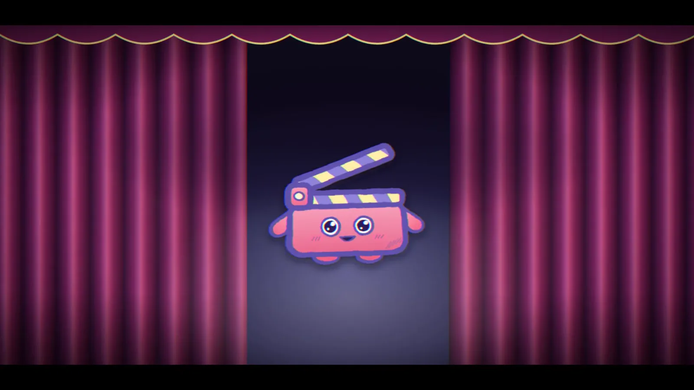
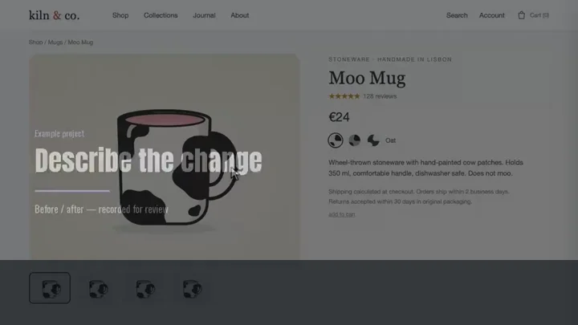
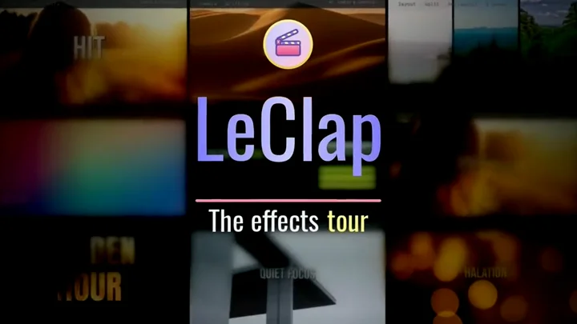

<div align="center">


# LeClap

**The video engine for AI agents.**

Build programmatic motion graphics with your AI agent: compose, validate, preview and render editable JSON templates through MCP or CLI. Bring your footage, typography, motion and music; render locally with FFmpeg.

[Connect your agent](https://leclap.dev/doc/agents) · [Try a browser sample — no upload](https://leclap.dev/#browser-demo) · [Watch a real workflow](https://leclap.dev/#agentic)

[](https://github.com/heristop/leclap/actions/workflows/ci.yml)
[](https://www.npmjs.com/package/ffmpeg-video-composer)
[](LICENSE)
[](TRADEMARK.md)

[Try it](#-try-it-in-30-seconds) · [Examples](#-template-in-video-out) · [Comparison](#-why-leclap) · [Docs](https://leclap.dev/doc) · [Showcase](https://leclap.dev/showcase)

</div>

## Built for the agent authoring loop

- **Structured authoring:** discover samples and motion primitives, then write against the template schema.
- **Precise revisions:** validate, inspect rendered frames, and patch the scenes that need work.
- **Human control:** keep the editable JSON and open it in the visual builder.
- **Local rendering:** use the CLI or MCP server on your computer; the same core also runs in browsers and native apps.

Make product demos, branded social clips or before/after review videos. LeClap composes existing assets; your agent supplies the creative decisions. Reproducible renders require the same inputs, configuration and runtime. An external AI provider has its own data handling, separate from local rendering.

Start with the [agent guide](docs/ai-agents.md): MCP setup, a first prompt, a CLI alternative and a revision workflow.

## 🎥 Demo

<a href="https://leclap.dev/#film"></a>

Click the frame: the film plays on [leclap.dev](https://leclap.dev/#film), with captions.

## ⏱ Try it in 30 seconds

Node 24.11 or later. FFmpeg is optional: the CLI brings `ffmpeg-static` along and uses it when there is no
`ffmpeg` on your PATH.

```bash
npx @leclap/cli init hello --no-remotion --no-mcp
cd hello && npm install && npm run render
```

That writes `build/output.mp4`: three seconds of "Hello, LeClap" on a navy card, from the
`template.json` next to it. Edit the JSON, render again.

If the title is missing, the `ffmpeg` on your PATH was built without `drawtext` (Homebrew's current build is
one). `npx leclap diagnose` lists what your FFmpeg can and can't do.

Rather not install anything? [Open the same template in the web builder](https://leclap.dev/studio/builder#t=v1.RZBBi9VAEIT_StNeFMaoKwjGm6ugKB4ET7IsnZlKMuy8njAzSfb5yH-XSZ5rHz-6q6rrwicU4fbCNkGKX_DJJ9jio3LLX7Wk6GYLigrqkqij1ZeRhBJySeIVzpCFFiQ4Kr6EuktCTtIDqSxnsqKL5IZ-ZdA6-gKyUR0014PzBEMDFCnOmRTDnoHyJBZU7aqTOOkCqPcqgcYYXEPfgIlOseakLnn0-_I0pylm9HP4QLJE78jG04TidaAR4oJXZIqJHGxMhxX6Hrbkhn5i8VipjKCMUsLTP1W5UqjzOjS8GR5C7CTU2mLy0CLXwoKoy1YmsOHTnL39rDW647aXkLEZzke5mdvfF1Y5gVvebdhwbYNbtjHEdN-JfRhSnNWx4Thdjy78n9_WPW752Wv3prsRNuzmdE3ydjPc-1CQDqertEuyFjwWNrxImLEr7qC9MOoHXxBCNPQdt0Gm-moftdh_Tv0-fNDs_4Db9-8MP3LLz9eXVeh-ffHqhg2fKxoPNB6o3vQ-1Bwf0Un-gRlNKT1v2912t_0F),
where it renders in the tab through WebAssembly. The template travels in the URL fragment, which browsers
don't send to servers. `leclap studio template.json` prints that link for any template.

## 🎞 Template in, video out

Three templates from this repo and what they render to. Click a frame to play the render.

| Template                                                                                       | Render                                                                                                                                                                                     | What it shows                                                                                                                                    |
| ---------------------------------------------------------------------------------------------- | ------------------------------------------------------------------------------------------------------------------------------------------------------------------------------------------ | ------------------------------------------------------------------------------------------------------------------------------------------------ |
| [`footage-edit.json`](examples/motion-design/footage-edit.json)<br/>4 KB of JSON               | <a href="https://leclap.dev/videos/showcase/footage-edit.mp4"></a>             | Five recorded clips, five edits: a portrait clip over its own blur, a keyframed pan under a LUT, a speed ramp, a freeze frame, a B-roll cutaway. |
| [`before-after.json`](examples/agentic-pr-video/before-after.json)<br/>a PR review clip        | <a href="https://leclap.dev/videos/showcase/before-after.mp4"></a> | The video an agent attaches to a pull request: the change named, the old behaviour, a wipe to the new one, what to check.                        |
| [`effects-tour.json`](examples/motion-design/effects-tour.json)<br/>ten chapters, one template | <a href="https://leclap.dev/videos/showcase/effects-tour.mp4"></a>         | Seven minutes of kinetic type, camera moves, transitions, captions, light effects, looks, footage edits, sound and music.                        |

All 59 samples, with their templates, are on the [showcase](https://leclap.dev/showcase). Each effect, one frame at a
time, in the [gallery](docs/gallery.md).

## 🤔 Why LeClap?

Four ways to get a video out of JavaScript, and when each one is the right call. Claims about the others come
from their own docs; a "—" means their docs don't say. The [full comparison](docs/comparison.md) has the
sources and the caveats, ours first.

|                         | **LeClap**                                                  | Remotion                                                                                 | editly                                       | fluent-ffmpeg                                         |
| ----------------------- | ----------------------------------------------------------- | ---------------------------------------------------------------------------------------- | -------------------------------------------- | ----------------------------------------------------- |
| What it is              | A JSON template compiled to FFmpeg                          | Videos written as React components                                                       | Declarative editing, as a CLI and a Node API | A chainable Node API over the `ffmpeg` CLI            |
| You write               | JSON, validated against a schema                            | React (TypeScript)                                                                       | A JSON5 spec or CLI flags                    | Chained method calls                                  |
| Node                    | ✅                                                          | ✅ also Lambda and Vercel                                                                | ✅ needs `ffmpeg`, `ffprobe`, headless GL    | ✅ needs `ffmpeg`, `ffprobe`                          |
| Browser                 | ✅ WebAssembly                                              | ✅ WebCodecs, since 4.0.491                                                              | —                                            | —                                                     |
| React Native, on-device | ✅ FFmpeg linked into the app                               | —                                                                                        | —                                            | —                                                     |
| Same input, same output | ✅ per platform¹                                            | ✅ if animations derive from the frame number                                            | —                                            | —                                                     |
| Agent tooling           | ✅ `@leclap/mcp`: schema, validate, render                  | ✅ a system prompt for LLMs writing React                                                | —                                            | —                                                     |
| Licence                 | MIT                                                         | Free for individuals, non-profits and for-profit companies up to 3 employees; paid above | MIT                                          | MIT, archived in May 2025                             |
| Pick it when            | The render happens in an app, or a program writes the video | You think in components, render on servers, or want the ecosystem                        | You want a slideshow from the terminal       | You already use it; its README says it's unmaintained |

<sub>¹ Per platform, not across them: Node and the browser encode with libx264, Android with `libopenh264`, iOS
with `h264_videotoolbox`, and the on-device build drops `boxblur` and rewrites `eq` to `lutyuv`. Same
composition, different pixels.</sub>

Remotion wins more of this than a comparison table usually admits: [LeClap vs Remotion](https://leclap.dev/compare/remotion)
spells out where.

## 📦 Packages

| Package                                                   | One line                                                                                        |
| --------------------------------------------------------- | ----------------------------------------------------------------------------------------------- |
| [`ffmpeg-video-composer`](packages/ffmpeg-video-composer) | The engine: `compile()` a JSON template on Node, in the browser or in React Native.             |
| [`@leclap/cli`](packages/leclap-cli)                      | The `leclap` command: `init`, `render`, `validate`, `snapshot`, `verify`, `studio`, `diagnose`. |
| [`@leclap/mcp`](packages/leclap-mcp)                      | The engine as tools an agent can call: read the schema, validate a template, render it.         |

The rest of the monorepo is private: the [creative kit](packages/leclap-creative-kit) (templates, fonts, media),
the [web builder](apps/leclap-web) (React, FFmpeg in WebAssembly), the [Expo app](apps/leclap-expo) (camera to
render, on the phone) and the [Rust engine](packages/ffmpeg-engine) that links FFmpeg into it. Working on the
repo itself: [CONTRIBUTING.md](CONTRIBUTING.md) and [AGENTS.md](AGENTS.md).

## 📚 Read next

- **[Descriptor reference](https://leclap.dev/doc)**: every section, transition, look, caption and filter, one page per topic.
- **[Template configuration](docs/template-configuration.md)** and **[effects](docs/effects-configuration.md)**: the same reference, in the repo.
- **[Engine configuration](docs/engine-configuration.md)**: `ProjectConfig`, environment variables, encoders.
- **[Architecture](docs/architecture.md)** and **[on-device compilation](docs/on-device-compilation.md)**: how one core runs on three FFmpeg builds.
- **[One descriptor, three FFmpeg builds](https://heristop.github.io/blog/2026-08-17-one-descriptor-three-ffmpeg-builds/)**: the long version, on the blog.
- **[Agent-made PR videos](examples/agentic-pr-video)** and **[browser agents in the builder](docs/webmcp.md)**.
- **[Showcase](https://leclap.dev/showcase)**: 50 templates with their renders.

## 🤝 Contributing & licence

Issues and PRs welcome: start with [CONTRIBUTING.md](CONTRIBUTING.md). The code is [MIT](LICENSE).

The **LeClap** name and logo are trademarks of Alexandre Mogère. Fork and reuse the code freely, but give your
fork a different name and don't imply endorsement. See [TRADEMARK.md](TRADEMARK.md).
